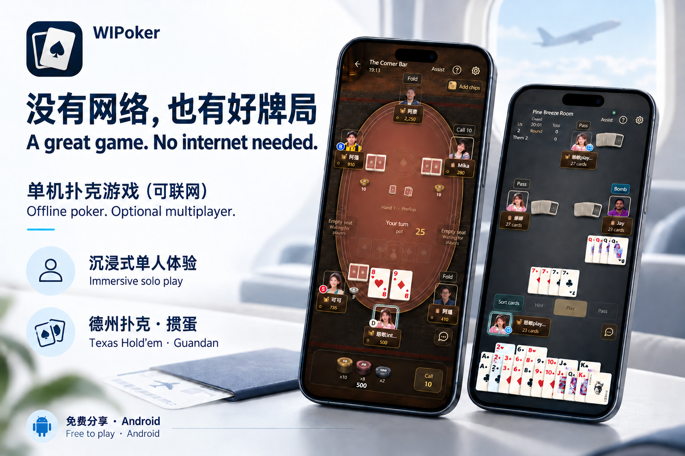
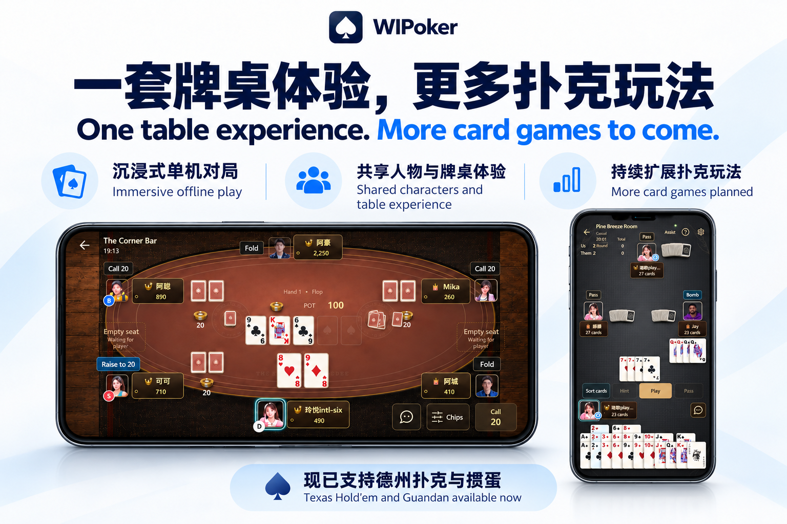
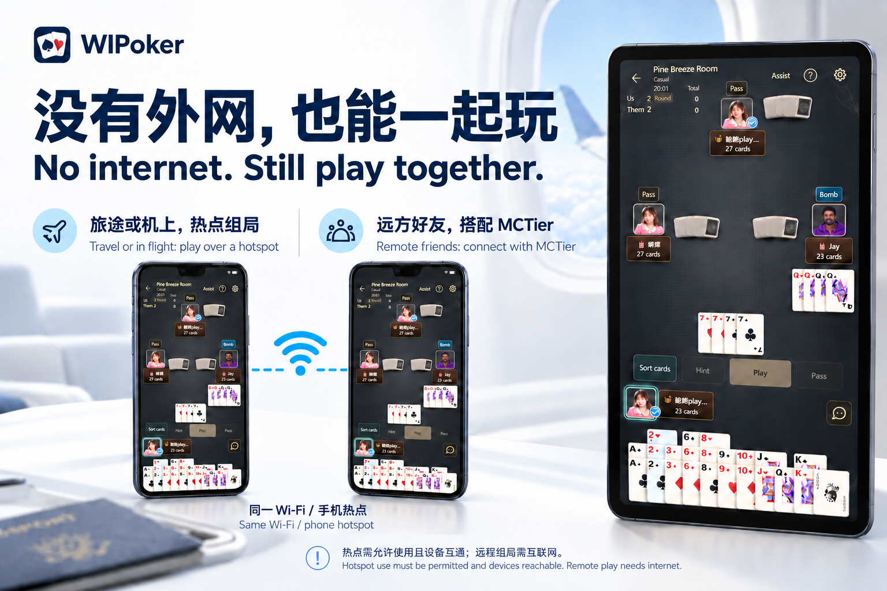
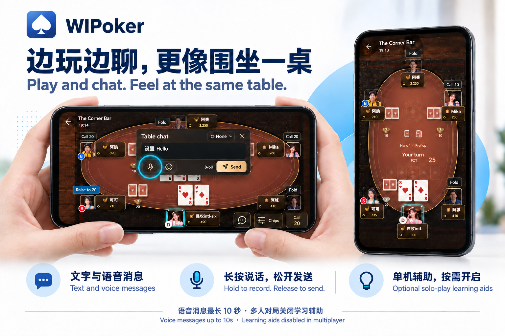

# WIPoker · Offline Poker for Android (Optional Multiplayer)

**English** · [简体中文](README.zh-CN.md)

[**Download Android APK →**](https://github.com/fnick6800/WIPoker/releases/latest) · [Get started](#get-started) · [Feedback](https://github.com/fnick6800/WIPoker/issues)

**A table for every trip. Play at your own pace.**

Play **Texas Hold'em and Guandan** against computer opponents, with animated cards and chips, character reactions and an immersive table atmosphere. Start on your own whenever you like; invite friends over Wi-Fi or a phone hotspot when you want company.

Android 7.0+ · Offline single-player · Optional LAN multiplayer · Free, non-profit sharing

## Get started

1. Open the [latest release](https://github.com/fnick6800/WIPoker/releases/latest), expand **Assets** and download the `.apk` file.
2. Install it on your Android device, then choose **Texas Hold'em** or **Guandan** in the lobby.
3. Play against the computer offline, or create a table for friends on the same Wi-Fi or phone hotspot.

**Updating? Install over your existing app to keep local saves. Do not uninstall first.** The “Source code” ZIP files are documentation, not the Android game.

## Your own table, wherever you are

Enjoy a full game on a flight, on a trip or whenever you're offline. Games and progress are saved locally, so you can return at your own pace. Hold'em supports portrait and landscape layouts; Guandan uses a portrait table with touch-based sorting and play.

### Why I built WIPoker

I wanted a simple, relaxing poker game on Android: something I could open during a journey, a flight or a quiet break, without needing an internet connection or a group of players. WIPoker grew out of that wish.

It is a personal, non-profit project, shared free of charge. The focus is enjoying the cards and the atmosphere of the table, with virtual chips and no real-money deposits or withdrawals. Play alone first; bring friends along when you feel like it.

## One table experience. More card games to come.

WIPoker is a growing **card-game platform**. New modes will build on familiar characters, table interactions and account progression while retaining their own rules and pace.

| Available game | What to expect |
| --- | --- |
| **Texas Hold'em** | Poker against computer opponents, with portrait and landscape layouts |
| **Guandan** | A four-player partnership card game, with AI opponents and teammates, a portrait table and touch-based card sorting |

**More card games are planned.** Details and timing will be announced in future updates.

## No internet. Still play together.

**Travel or in flight: play over a hotspot.** Nearby friends can play over the same phone hotspot or Wi-Fi without internet, where hotspot use is permitted and devices can communicate.

| Who's playing? | How to connect |
| --- | --- |
| Just you | Play offline against computer opponents |
| Friends nearby | Join the same Wi-Fi or phone hotspot, then create or join a table |
| Friends in different locations | Connect through [MCTier](https://github.com/pmh1314520/MCTier) or another compatible virtual LAN tool |

[MCTier project](https://github.com/pmh1314520/MCTier) · [Download MCTier](https://github.com/pmh1314520/MCTier/releases). Remote play needs internet and working device connectivity. An ordinary internet proxy is not a virtual LAN. There is no public matchmaking lobby.

## Play and chat. Feel at the same table.

Send text, emoji and mentions at the table. Hold to record, release to send, or swipe up to cancel a voice message. Each message lasts up to 10 seconds, with optional voice tones and independent voice volume.

Optional single-player hand information, estimated win probability and move explanations help you understand decisions. Estimates use your own cards and public information, never reveal opponents' hidden cards, and do not guarantee a win. Learning aids are disabled in multiplayer.

## Useful details

- The international edition supports Simplified Chinese and English in **Settings → Language / 语言**. Recorded character voices retain their original language; names and chat are not automatically translated. Check individual release notes for older packages.
- Free, non-profit sharing. Virtual chips only, with no real-money deposits or withdrawals.

## Help shape the next table

Enjoying WIPoker? **Star this repository** to bookmark it and support the project, or share the official download page with friends. To receive release notifications, use **Watch → Custom → Releases** on GitHub.

[Report a bug or suggest a card game](https://github.com/fnick6800/WIPoker/issues). For bugs, include your device, app version and reproduction steps.

About this repository and permissions

This is the **official product information and APK distribution repository**. It contains documentation, promotional material, release notes and downloadable packages, not the game's source code. GitHub's automatic “Source code” archives contain only this distribution repository's documents and assets.

Personal free play and sharing official links are welcome. Repackaging, reskin releases or commercialization require permission. See [Usage](USAGE.md) and [Third-party notices](THIRD_PARTY_NOTICES.md).

Promotional images use real game screenshots with AI-assisted layout. [Original captures and provenance](images/README.md) are provided separately.
